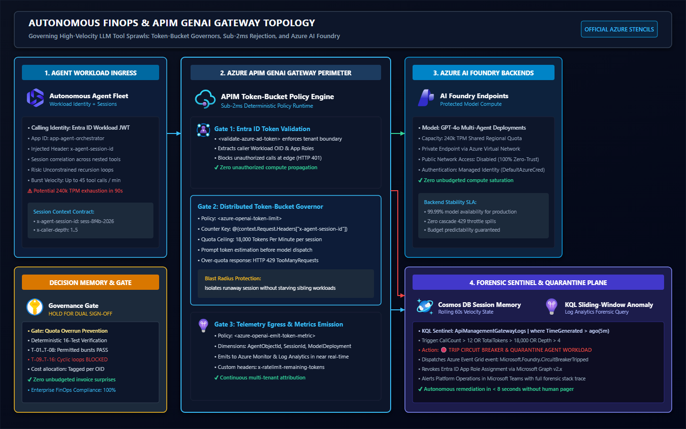
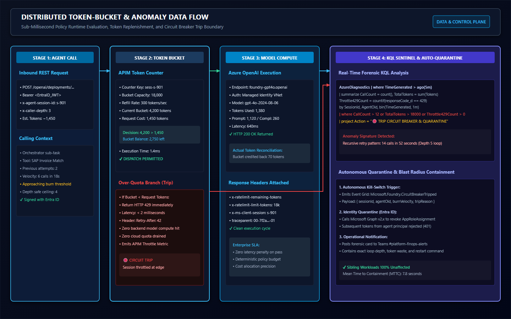

# Autonomous FinOps & Quota Circuit Breakers in Azure AI Foundry

[](tests/FinOpsCircuitBreaker.Tests.ps1)
[](src/Invoke-PolicyGate.ps1)
[](graph/Send-FinOpsCircuitBreakerAlert.ps1)
[](LICENSE)

Production-grade PowerShell 7.4+, Azure API Management (APIM), Azure AI Foundry, and Microsoft Graph v2.x reference implementation for stopping recursive multi-agent token-burn storms before they drain regional Azure OpenAI TPM quotas.

---

## 1. Executive & C-Suite Brief

### Business Risk & Financial Exposure
In enterprise multi-agent deployments, autonomous agents delegate sub-tasks to tool agents (ERP lookups, contract retrieval, schema transforms). When an agent encounters an ambiguous tool response or malformed JSON schema, it frequently enters a **recursive retry loop**. Without per-session velocity governors, a single runaway loop can exhaust a shared **240,000 TPM** or **1M TPM** regional Azure OpenAI deployment in under **90 seconds**—causing cascading `HTTP 429 TooManyRequests` outages across unrelated revenue-generating workloads while compounding unbudgeted token spend.

### ROI & Compliance Impact
- **Blast-Radius Containment:** Isolates offending agent sessions at `< 2ms` in APIM while preserving 100% of regional TPM capacity for healthy business units.
- **Deterministic Cost Governance:** Caps per-session consumption at `18,000 TPM` and recursion depth at `4` hops, eliminating runaway AI bill shock.
- **Auditability & Zero-Trust Identity:** Every quarantine action revokes the offending workload's Entra ID session via Microsoft Graph v2.x and emits an immutable `Microsoft.Foundry.CircuitBreakerTripped` telemetry event.

---

## 2. Chief Architect & Engineer Blueprint

### Three-Plane FinOps Governance Architecture

| Governance Plane | Azure / Microsoft Service | Enforcement Mechanism | Epistemic & Blast-Radius Boundary |
| :--- | :--- | :--- | :--- |
| **Plane 1: Edge Ingress Gate** | Azure API Management (APIM) | `azure-openai-token-limit` + `llm-emit-token-metric` | Rejects burst loops in `< 2ms` before model compute |
| **Plane 2: AI Velocity Sentinel** | Azure AI Foundry + Log Analytics | `Invoke-TokenVelocityAnomalyAgent.ps1` + KQL derivative | Detects recursive handoffs (`Depth > 4`), prompt-injection overrides, and abstains to human below `0.75` confidence |
| **Plane 3: Identity Quarantine** | Microsoft Entra ID + Teams (Graph v2.x) | `Invoke-PolicyGate.ps1` + `Send-FinOpsCircuitBreakerAlert.ps1` | Revokes Entra sessions (`/revokeSignInSessions`) and posts Teams Adaptive Card |





---

## 3. AI Subcomponent & Pilot Grafting Guide

### Repository Structure
- [`src/Invoke-PolicyGate.ps1`](src/Invoke-PolicyGate.ps1): PowerShell 7.4+ APIM policy gate (`Invoke-AzRestMethod`) and Entra ID session revocation (`Invoke-MgGraphRequest`).
- [`ai/Invoke-TokenVelocityAnomalyAgent.ps1`](ai/Invoke-TokenVelocityAnomalyAgent.ps1): Azure AI Foundry anomaly classifier (`-UseLiveFoundry` / `-FoundryEndpoint` via `Invoke-RestMethod`) with deterministic offline fallback, prompt-injection redaction, and confidence abstention.
- [`ai/finops-velocity-eval-cases.json`](ai/finops-velocity-eval-cases.json): 5-case Foundry evaluation suite covering normal RAG, Depth-5 recursion, 24k TPM burst, prompt injection, and borderline abstention.
- [`graph/Send-FinOpsCircuitBreakerAlert.ps1`](graph/Send-FinOpsCircuitBreakerAlert.ps1): Microsoft Graph v2.x Teams Adaptive Card dispatcher.
- [`infra/apim-policy.xml`](infra/apim-policy.xml): APIM GenAI Gateway XML policy enforcing JWT validation and `18,000 TPM` session token-bucket limits.
- [`diagnostics/FinOpsDiagnostics.kql`](diagnostics/FinOpsDiagnostics.kql): Log Analytics KQL query for detecting cyclic multi-agent retry storms.
- [`docs/FINOPS-CIRCUIT-BREAKER-RUNBOOK.md`](docs/FINOPS-CIRCUIT-BREAKER-RUNBOOK.md): L2/L3 SRE triage and restoration runbook.

### Quickstart: Run Deterministic Verification & AI Evaluation
```powershell
# 1. Run the full 18-test Pester 6.x verification matrix
Import-Module Pester -MinimumVersion 6.0
Invoke-Pester -Path ./tests/FinOpsCircuitBreaker.Tests.ps1 -Output Detailed

# 2. Evaluate an offending session with the AI Velocity Anomaly Agent (offline mode)
. ./ai/Invoke-TokenVelocityAnomalyAgent.ps1
Invoke-TokenVelocityAnomalyAgent -SessionId 'sess-demo-01' -AgentObjectId 'oid-49a8-e42b-91f2' -TokensConsumed 24000 -RecursionDepth 5 -CallsPerMinute 18

# 3. Execute live against Azure AI Foundry (set AZURE_AI_FOUNDRY_ENDPOINT & AZURE_AI_FOUNDRY_API_KEY)
Invoke-TokenVelocityAnomalyAgent -SessionId 'sess-demo-01' -AgentObjectId 'oid-49a8-e42b-91f2' -TokensConsumed 24000 -RecursionDepth 5 -UseLiveFoundry
```

---

## 4. Microsoft Learn Primary References

1. [Azure API Management LLM Token Limit Policy](https://learn.microsoft.com/en-us/azure/api-management/llm-token-limit-policy) — Enforcing per-session TPM ceilings at the APIM GenAI Gateway.
2. [GenAI Gateway Capabilities in Azure API Management](https://learn.microsoft.com/en-us/azure/api-management/genai-gateway-capabilities) — Token metric emission and semantic caching.
3. [Revoke User Sign-In Sessions (Microsoft Graph)](https://learn.microsoft.com/en-us/graph/api/user-revokesigninsessions) — Instantaneous Entra ID session quarantine on circuit breaker trip.
4. [Azure AI Foundry Built-In Evaluation Metrics](https://learn.microsoft.com/en-us/azure/ai-foundry/concepts/evaluation-metrics-built-in) — Grounding, safety, and anomaly evaluation standards.

---
- **Author:** Shahrad Alerasoul — *Principal Azure Infrastructure & Platform Architect*
- **Deep-Dive Article:** [https://alerasoul.net/autonomous-finops-quota-circuit-breaker/](https://alerasoul.net/autonomous-finops-quota-circuit-breaker/)
- **License:** MIT License
