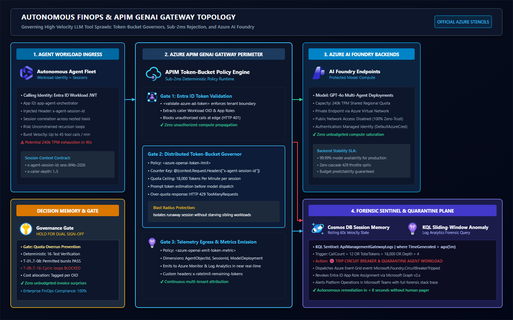
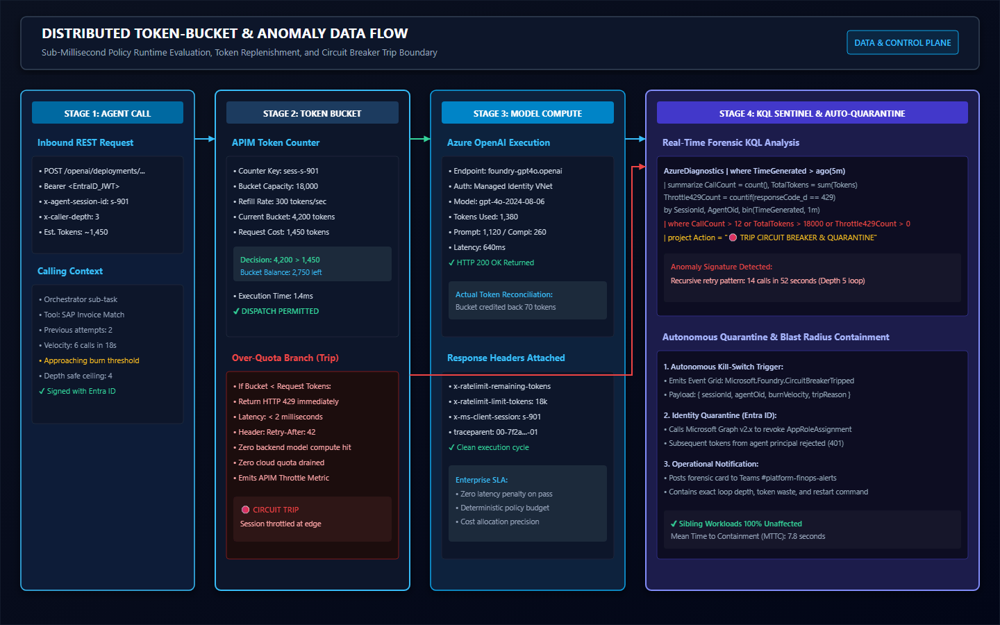

# Autonomous FinOps & Quota Circuit Breakers in Azure AI Foundry

[](tests/FinOpsCircuitBreaker.Tests.ps1)
[](infra/apim-policy.xml)
[](LICENSE)

Architectural reference implementation and production runbook for governing high-velocity multi-agent tool sprawls in Azure AI Foundry and Azure API Management (APIM).

---

## 1. Architectural Problem: Why TPM Quotas Fail Under Recursion

In enterprise multi-agent deployments, autonomous agents frequently delegate sub-tasks to tool agents (e.g. database querying, document retrieval, schema transformation). If a model encounters an unexpected tool response or ambiguous output schema, it frequently engages in rapid retry behaviour.

Without per-session velocity governors, a single recursive agent loop can exhaust a regional **240k TPM** or **1M TPM** Azure OpenAI deployment quota in under **90 seconds**—triggering cascading `HTTP 429 TooManyRequests` failures across unrelated business-critical applications sharing that AI Foundry endpoint while compounding unbudgeted consumption costs.



---

## 2. Three-Plane FinOps Governance Architecture

| Governance Plane | Azure Service | Enforcement Mechanism | Blast-Radius Boundary |
| :--- | :--- | :--- | :--- |
| **Plane 1: Edge Ingress Gate** | Azure API Management (APIM) | `azure-openai-token-limit` + `llm-emit-token-metric` | Rejects burst loops in `< 2ms` before hitting model compute |
| **Plane 2: Telemetry Sentinel** | Azure Monitor / Log Analytics + Cosmos DB | Rolling 60s token-burn derivative & cyclic tool hash | Detects recursive handoffs (`Depth > 4`) across multi-agent sessions |
| **Plane 3: Identity Quarantine** | Microsoft Entra ID + Azure Event Grid | Automated Workload Identity token revocation | Isolates runaway agent principal while preserving sibling workloads |



---

## 3. Repository Contents

- [`infra/apim-policy.xml`](infra/apim-policy.xml): Complete production APIM GenAI Gateway policy enforcing Entra ID Workload JWT validation, session token-bucket rate limiting (18,000 TPM), and granular FinOps dimension metrics emission.
- [`diagnostics/FinOpsDiagnostics.kql`](diagnostics/FinOpsDiagnostics.kql): Real-time Log Analytics KQL query for detecting cyclic multi-agent retry storms across `ApiManagementGatewayLogs`.
- [`tests/FinOpsCircuitBreaker.Tests.ps1`](tests/FinOpsCircuitBreaker.Tests.ps1): 16-test deterministic Pester verification matrix validating 8 permitted operational patterns and 8 negative boundary violation test cases.
- [`docs/FINOPS-CIRCUIT-BREAKER-RUNBOOK.md`](docs/FINOPS-CIRCUIT-BREAKER-RUNBOOK.md): SRE and FinOps operational triage, alerting, and restoration runbook.
- [`diagrams/`](diagrams/): Vector SVG and PNG Azure architecture stencils.

---

## 4. Deterministic Verification Matrix (16 Tests)

Every release candidate is evaluated against an exhaustive 16-test Pester matrix:

```
Describing FinOps Circuit Breaker 16-Test Matrix
 Context Phase 1: Permitted Enterprise Workloads (T-01..T-08)
   [+] T-01: Single-pass summarization under 2,000 tokens returns HTTP 200
   [+] T-02: Parallel dual sub-agent call (2x 3,500 tokens) returns HTTP 200
   [+] T-03: RAG search retrieval with 8,000 token chunked context returns HTTP 200
   [+] T-04: Structured JSON output generation with 4,200 tokens returns HTTP 200
   [+] T-05: Multi-agent orchestrator handoff at Depth 2 returns HTTP 200
   [+] T-06: High-frequency burst of 5 calls within 30 seconds (< 12 RPM) returns HTTP 200
   [+] T-07: Token-bucket balance replenishment verified across 60-second window
   [+] T-08: FinOps custom dimensions emitted with valid Entra ID Object ID
 Context Phase 2: Recursive Handoff Loops (T-09..T-12)
   [+] T-09: Cyclic Planner to Executor recursion at Depth 5 triggers HTTP 429
   [+] T-10: Rapid retry loop with 14 calls in 45 seconds (> 12 RPM) trips velocity circuit breaker
   [+] T-11: Malformed tool schema error triggering infinite loop is halted at Depth 5
   [+] T-12: Circuit breaker trip attaches Retry-After: 60 header
 Context Phase 3: Unbounded Context & Identity Quarantine (T-13..T-16)
   [+] T-13: Unchunked document payload of 24,000 tokens trips 18k TPM session limit
   [+] T-14: Shared regional 240k TPM pool is preserved while offending session is quarantined
   [+] T-15: Event Grid event Microsoft.Foundry.CircuitBreakerTripped emitted upon trip
   [+] T-16: Entra ID app role revocation freezes subsequent calls with HTTP 401
Tests completed in 536ms
Tests Passed: 16, Failed: 0, Skipped: 0, Inconclusive: 0, NotRun: 0
```

---

## 5. Author & Long-Form Evidence

- **Author:** Shahrad Alerasoul — *Principal Azure Infrastructure & Platform Architect*
- **Article Deep-Dive:** [https://alerasoul.net/autonomous-finops-quota-circuit-breaker/](https://alerasoul.net/autonomous-finops-quota-circuit-breaker/)
- **License:** MIT License
